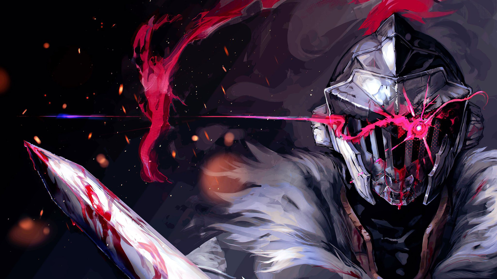
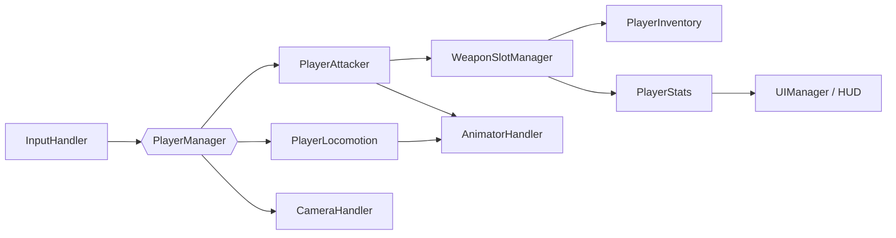

<div align="center">



<h1>Souls-Like Prototype</h1>

<p><b>Боевой каркас souls-like action RPG от третьего лица</b></p>

<p><i>«Перекат, удар, захват цели — и снова перекат.»</i></p>

<p>


</p>

<p>
<a href="#об-игре">Об игре</a> ·
<a href="#быстрый-старт">Быстрый старт</a> ·
<a href="#возможности">Возможности</a> ·
<a href="#управление">Управление</a> ·
<a href="#архитектура">Архитектура</a> ·
<a href="#сторонние-ассеты">Ассеты</a>
</p>

</div>

---

## Об игре

Прототип souls-like игры от третьего лица: передвижение, перекаты, прыжки, оружие, комбо, выносливость, захват цели и инвентарь — всё, из чего складывается бой в духе Dark Souls.

Основа проекта — видео-туториал [«Create DARK SOULS in Unity»](https://www.youtube.com/playlist?list=PLD_vBJjpCwJtrHIW1SS5_BNRk6KZJZ7_d), но многие системы переписаны и доработаны. Каждое отличие от туториала объяснено в комментарии прямо в коде.

> `Souls-Like-Prototype` — рабочее название репозитория, а не название игры.

| | |
|---|---|
| **Жанр** | Souls-like action RPG от третьего лица |
| **Движок** | Unity 6 (6000.3.8f1), Universal Render Pipeline |
| **Платформа** | PC, клавиатура и мышь или геймпад |
| **Основа** | Видео-туториал «Create DARK SOULS in Unity» |
| **Разработчик** | Piperite Games |

## Быстрый старт

> Нужны **Unity 6000.3.8f1** (через Unity Hub) и сторонние ассеты из раздела [ниже](#сторонние-ассеты). Без них не будет анимаций, моделей оружия, эффектов и спрайтов интерфейса.

1. Склонируйте репозиторий:
   ```bash
   git clone https://github.com/KyomuTenshi/Souls-Like-Prototype.git
   ```
2. Положите каждый пак ассетов в `Assets/_ThirdParty/` под именем папки из таблицы.
3. В Unity Hub нажмите **Add** → **Add project from disk** и выберите папку репозитория.
4. Откройте `Assets/_Project/Scenes/SampleScene.unity` и нажмите **Play**.

В сцене есть пол и стены, тренировочный враг, огонь с уроном и два меча для подбора.

## Возможности

- **Передвижение.** Ходьба, бег и спринт относительно камеры, торможение после спринта.
- **Перекат и бэкстеп.** Короткое нажатие — перекат или шаг назад, удержание той же кнопки — спринт. Дистанция задаётся в инспекторе, а не длиной анимации.
- **Прыжок и падение.** Прыжок с места и с разбега, падение с уступов, мягкое и тяжёлое приземление.
- **Бой.** Лёгкие и тяжёлые атаки, серии до четырёх ударов, урон и окна комбо через события анимации.
- **Двуручный хват.** Оружие перехватывается двумя руками, второе уходит за спину.
- **Захват цели.** Lock-on ближайшего видимого врага, переключение между целями, стрейф вокруг цели.
- **Здоровье и выносливость.** Каждая атака тратит выносливость, урон и смерть сопровождаются анимациями.
- **Оружие и инвентарь.** Предметы на ScriptableObject, по два слота на руку, быстрая смена оружия, окна экипировки и инвентаря.
- **Подбор предметов.** Подсказка рядом с предметом, анимация подбора и всплывающее окно с иконкой.
- **HUD.** Полосы здоровья и выносливости, иконки оружия в быстрых слотах.

## Управление

| Действие | Клавиатура и мышь | Геймпад |
|---|---|---|
| Движение | `W` `A` `S` `D` | Левый стик |
| Камера | Мышь | Правый стик |
| Перекат / бэкстеп (нажатие) | `Left Shift` | `B` / `○` |
| Спринт (удержание) | `Left Shift` | `B` / `○` |
| Прыжок | `Space` | `Y` / `△` |
| Лёгкая атака | `ЛКМ` | `RB` / `R1` |
| Тяжёлая атака | `ПКМ` | `RT` / `R2` |
| Взаимодействие, подбор | `E` | `A` / `✕` |
| Захват цели | `F` или `СКМ` | Нажатие правого стика |
| Сменить цель влево / вправо | `1` / `2` | Правый стик влево / вправо |
| Двуручный хват | `T` | `View` / `Select` |
| Оружие в правой / левой руке | `→` / `←` | D-pad вправо / влево |
| Инвентарь | `Esc` | `Menu` / `Start` |

Перекат срабатывает, если кнопку отпустили быстрее `rollTapTime` (0,25 с), иначе это спринт. Привязки лежат в `Assets/_Project/Input/PlayerControls.inputactions`.

## Как устроены механики

<details>
<summary><b>Перемещение и прыжок</b></summary>
<br>

Ролл, бэкстеп и торможение после спринта двигают персонажа не через root motion, а по дистанции и длительности из инспектора (`PlayerLocomotion`). Длина пути не зависит от клипа и переходов Animator, а скорость в конце действия плавно падает до нуля. Флаг `useManualRollMovement` возвращает root motion.

Прыжок задаёт только начальную скорость, рассчитанную из `jumpHeight` и `jumpDistance`, дальше персонажа ведёт та же физика, что и при падении. Если падение длилось дольше `hardLandingFallTime`, приземление тяжёлое и управление заблокировано до конца анимации.

Земля определяется лучом, смещённым по направлению движения, и дополнительным `SphereCast`, поэтому персонаж не теряет опору на краю уступа.

</details>

<details>
<summary><b>Бой и события анимации</b></summary>
<br>

| Событие анимации | Что делает |
|---|---|
| `EnableCombo` / `DisableCombo` | Открывают и закрывают окно для продолжения серии |
| `OpenRightDamageCollider` / `CloseRightHandDamageCollider` | Включают и выключают триггер урона на клинке |
| `DrainStaminaLightAttack` / `DrainStaminaHeavyAttack` | Списывают выносливость за атаку |

Урон наносит `DamageCollider` на модели оружия: по объектам с тегами `Enemy` и `Hittable`. Максимум здоровья и выносливости — уровень × 10.

| Оружие | Урон | Лёгкая атака | Тяжёлая атака |
|---|---|---|---|
| Sword | 10 | 10 выносливости | 20 выносливости |
| Butcher Sword | 25 | 15 выносливости | 30 выносливости |

Новое оружие создаётся через **Create → Items → Weapon**: модель, иконка, анимации стоек и атак, стоимость атак.

</details>

<details>
<summary><b>Захват цели</b></summary>
<br>

Цели ищутся среди `CharacterManager` в пределах `maximumLockOnDistance` и в секторе ±50° от направления камеры. Враг за стеной слоя `Environment` не захватывается. Соседняя цель выбирается по горизонтали экрана относительно текущей.

</details>

## Архитектура

Игрок собран по схеме «менеджер и обработчики»: `PlayerManager` задаёт порядок обновления, а каждый обработчик отвечает за свою часть.



| Компонент | Ответственность |
|---|---|
| `PlayerManager` | `Update` — ввод и действия, `FixedUpdate` — движение и падение, `LateUpdate` — камера и сброс одноразовых флагов |
| `InputHandler` | Чтение ввода, перекат или спринт по длительности нажатия, комбо, меню, захват цели |
| `PlayerLocomotion` | Движение, повороты, ролл, бэкстеп, прыжок, падение и приземление |
| `AnimatorHandler` | Параметры Animator, веса слоёв рук, root motion, события комбо |
| `CameraHandler` | Следование, вращение, столкновения камеры и поиск целей |
| `PlayerAttacker` | Запуск атак и продолжение серий |
| `WeaponSlotManager` | Модели оружия в руках, стойки, триггеры урона, списание выносливости |
| `PlayerInventory` | Слоты рук, быстрая смена оружия, подобранное оружие |
| `PlayerStats` / `EnemyStats` | Здоровье, выносливость и реакция на урон |
| `UIManager` | Окна HUD, экипировки и инвентаря |

**Ключевые решения**

- Любое действие запускается через `AnimatorHandler.PlayTargetAnimation` и блокирует остальные до своего окончания.
- `Humanoid.controller` разделён на слои: базовая локомоция, `Override` для действий и слои рук для стоек с оружием.
- Однократные нажатия живут один кадр и сбрасываются в `LateUpdate`.
- Параметры движения, перекатов, прыжка и камеры вынесены в инспектор с подсказками.

<details>
<summary><b>Структура проекта</b></summary>
<br>

```text
Assets/
├── _Project/
│   ├── Art/Materials/          # материалы тестовой сцены
│   ├── Data/                   # оружие (WeaponItem) и его префабы
│   ├── Editor/                 # меню Tools → Dungeon Environment
│   ├── Gameplay/
│   │   ├── Characters/         # CharacterManager, CharacterStats
│   │   ├── Combat/             # урон и оружие
│   │   ├── Enemies/            # враг и его характеристики
│   │   ├── Items/              # предметы и подбор
│   │   └── Player/             # анимация, камера, бой, инвентарь, движение
│   ├── Input/                  # Input Actions и InputHandler
│   ├── Scenes/                 # SampleScene
│   ├── UI/                     # HUD, экипировка, инвентарь, шрифты, иконки
│   └── Utilities/              # ResetAnimatorBool
├── _ThirdParty/                # сторонние ассеты, в репозиторий не входят
├── Scenes/                     # сцена GUI_Fantasy_Kit со спрайтами интерфейса
├── Settings/                   # профили URP
└── Fire.prefab                 # огонь с уроном по игроку
```

</details>

## Ограничения

- Враг — тренировочная цель: получает урон, но не двигается и не атакует.
- Выносливость только тратится и пока не восстанавливается.
- Блока, парирования, экрана смерти и сохранений нет.
- В `Player.prefab` коллайдер ссылается на физический материал, которого нет в проекте.

## Стек

| | |
|---|---|
| **Движок** | Unity 6000.3.8f1 |
| **Язык** | C# (namespace `SG`) |
| **Рендер** | Universal Render Pipeline 17.3.0 |
| **Ввод** | Input System 1.18.0, сгенерированный класс `PlayerControls` |
| **Интерфейс** | uGUI 2.0.0, TextMeshPro |
| **Шрифты** | Noto Sans, IM Fell English (SIL OFL) |

Остальные пакеты — в [`Packages/manifest.json`](Packages/manifest.json).

## Сторонние ассеты

Папка `Assets/_ThirdParty/` не хранится в репозитории: это сторонние ассеты со своими лицензиями, их нужно скачать отдельно.

| Ассет | Папка в `Assets/_ThirdParty/` | Для чего | Лицензия |
|---|---|---|---|
| Universal Animation Library (Pro и 2 Source) | `Universal Animation Library[Pro]`, `Universal Animation Library 2[Source]` | Анимации персонажа и манекен | `License.txt` внутри пака |
| Анимации Kevin Iglesias | `Kevin Iglesias` | Двуручная стойка | По странице автора |
| Free medieval weapons | `Free medieval weapons` | Модели мечей | По странице автора |
| AllSkyFree | `AllSkyFree` | Скайбоксы | По странице автора |
| Game VFX - MagicCircle | `Game VFX - MagicCircle` | Эффекты | По странице автора |
| Vefects — Free Fire VFX URP | `Vefects` | Огонь | По странице автора |
| GUI Fantasy Kit | `GUI_Fantasy_Kit` | Спрайты интерфейса | По странице автора |
| Dungeon Environment | `Dungeon_Environment` | Окружение для **Tools → Dungeon Environment** | По странице автора |

Шрифты лежат в репозитории (`Assets/_Project/UI/Font/`), иконки оружия в `Assets/_Project/UI/Icon/` взяты с [pngtree.com](https://pngtree.com).

---

<div align="center">
<sub>Сделано <a href="https://github.com/KyomuTenshi">KyomuTenshi</a> · Piperite Games</sub>
</div>
