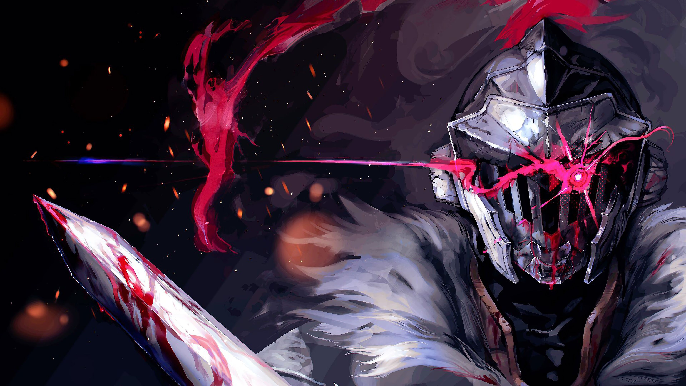

# SOULS-LIKE PROTOTYPE



> *Перекат, удар, захват цели — и снова перекат. Боевой каркас souls-like игры от третьего лица.*

Прототип souls-like action RPG от третьего лица на Unity 6. Проект собирается по видео-туториалу [«Create DARK SOULS in Unity»](https://www.youtube.com/playlist?list=PLD_vBJjpCwJtrHIW1SS5_BNRk6KZJZ7_d), но многие системы переписаны и доработаны: каждое отличие от туториала объяснено в комментарии прямо в коде.

`Souls-Like-Prototype` — рабочее название репозитория, а не название игры.

---

## Общее

| Параметр | Значение |
|---|---|
| **Жанр** | Souls-like action RPG от третьего лица |
| **Движок** | Unity 6 (`6000.3.8f1`), URP |
| **Язык** | C# (namespace `SG`) |
| **Платформа** | PC; управление с клавиатуры и мыши или с геймпада |
| **Разработчик** | Piperite Games |
| **Статус** | Прототип: механики игрока и боя, одна тестовая сцена |

---

## Реализованные системы

| Система | Статус | Описание |
|---|---|---|
| **Передвижение** | ✅ | Ходьба, бег и спринт относительно камеры; анимация торможения после спринта (`Sprint_Exit`) |
| **Перекат и бэкстеп** | ✅ | Короткое нажатие — перекат в сторону движения, без направления — шаг назад; удержание той же кнопки — спринт |
| **Прыжок и падение** | ✅ | Прыжок на месте и с разбега, падение с уступов, мягкое и тяжёлое приземление |
| **Атаки и комбо** | ✅ | Лёгкая и тяжёлая атака, цепочки до четырёх ударов; окно комбо и урон задаются событиями анимации |
| **Выносливость** | ✅ | Каждая атака тратит выносливость: базовая стоимость оружия × множитель лёгкой или тяжёлой атаки |
| **Здоровье и урон** | ✅ | Анимации получения урона и смерти, повторный урон по мёртвому персонажу игнорируется |
| **Двуручный хват** | ✅ | Переключение хвата оружия в правой руке; во время действия хват не меняется |
| **Захват цели (lock-on)** | ✅ | Захват ближайшей видимой цели, переключение влево и вправо, стрейф вокруг цели, смена высоты камеры |
| **Камера** | ✅ | Свободный обзор мышью или стиком, сглаженное следование за персонажем, обработка столкновений со стенами |
| **Оружие и экипировка** | ✅ | ScriptableObject-предметы, по два слота на каждую руку, быстрая смена оружия, режим без оружия |
| **Подбор предметов** | ✅ | Подсказка рядом с предметом, анимация подбора, всплывающее окно с названием и иконкой |
| **Инвентарь** | ✅ | Окно экипировки и окно инвентаря оружия; пока меню открыто, игровой ввод отключён и виден курсор |
| **HUD** | ✅ | Полосы здоровья и выносливости, иконки оружия в быстрых слотах |
| **Враги** | ✅ | Тренировочная цель со здоровьем: получает урон, проигрывает анимации урона и смерти |
| **Опасные зоны** | ✅ | Триггер `DamagePlayer` наносит урон игроку при входе (огонь `Fire.prefab`) |

## Пока не реализовано

| Раздел | Статус | Описание |
|---|---|---|
| **ИИ врагов** | ⏳ | Враг не двигается и не атакует (`EnemyManager` пока пустой) |
| **Восстановление выносливости** | ⏳ | Выносливость только тратится, и при нуле действия не блокируются |
| **Блок и парирование** | ⏳ | В коде нет |
| **Смерть и возрождение** | ⏳ | После смерти нет экрана поражения и точки возрождения |
| **Сохранения, прогрессия, боссы** | ⏳ | В коде нет |

---

## Управление

Привязки заданы в `Assets/_Project/Input/PlayerControls.inputactions` (Input System).

| Действие | Клавиатура и мышь | Геймпад |
|---|---|---|
| Движение | `W` `A` `S` `D` | Левый стик |
| Камера | Мышь | Правый стик |
| Перекат / бэкстеп (нажатие) | `Left Shift` | `B` / `○` |
| Спринт (удержание) | `Left Shift` | `B` / `○` |
| Прыжок | `Space` | `Y` / `△` |
| Лёгкая атака | `ЛКМ` | `RB` / `R1` |
| Тяжёлая атака | `ПКМ` | `RT` / `R2` |
| Взаимодействие, подбор | `E` | `A` / `✕` |
| Захват цели | `F` или `СКМ` | Нажатие правого стика |
| Сменить цель влево / вправо | `1` / `2` | Правый стик влево / вправо |
| Двуручный хват | `T` | `View` / `Select` |
| Оружие в правой / левой руке | `→` / `←` | D-pad вправо / влево |
| Инвентарь | `Esc` | `Menu` / `Start` |

Перекат срабатывает, если кнопку отпустили быстрее `rollTapTime` (0.25 с по умолчанию), иначе это спринт. Действия `D-Pad Up` и `D-Pad Down` привязаны к `↑` и `↓`, но в коде пока не используются.

---

## Игровые механики

### Перемещение и действия

Ролл, бэкстеп и торможение после спринта двигают персонажа не через root motion, а по дистанции и длительности из инспектора (`PlayerLocomotion`). Поэтому длина пути не зависит от длины клипа и настроек переходов Animator, а скорость в конце действия плавно падает до нуля. Флаг `useManualRollMovement` возвращает root motion.

Прыжок задаёт только начальную скорость, рассчитанную из `jumpHeight` и `jumpDistance`, дальше персонажа ведёт та же физика, что и при падении. Если падение длилось дольше `hardLandingFallTime`, приземление тяжёлое и управление заблокировано до конца анимации; после обычного прыжка анимацию приземления можно прервать движением или перекатом.

Земля определяется лучом, смещённым по направлению движения, и дополнительным `SphereCast` из-под персонажа, поэтому он не теряет опору на краю уступа.

### Бой

Атаки берут имена анимаций из `WeaponItem`. События анимации управляют всем боем:

| Событие анимации | Что делает |
|---|---|
| `EnableCombo` / `DisableCombo` | Открывают и закрывают окно, в котором следующее нажатие продолжает серию |
| `OpenRightDamageCollider` / `CloseRightHandDamageCollider` | Включают и выключают триггер урона на клинке |
| `DrainStaminaLightAttack` / `DrainStaminaHeavyAttack` | Списывают выносливость за атаку |

Урон наносит `DamageCollider` на модели оружия: по объектам с тегом `Enemy` (через `EnemyStats`) и `Hittable` (через `PlayerStats`).

Максимум здоровья и выносливости считается как уровень × 10, по умолчанию 100 и 100.

### Оружие

| Оружие | Модель | Урон | Лёгкая атака | Тяжёлая атака |
|---|---|---|---|---|
| **Sword** | `Sword_01.prefab` | 10 | 10 выносливости | 20 выносливости |
| **Butcher Sword** | `Sword_02.prefab` | 25 | 15 выносливости | 30 выносливости |

Новое оружие создаётся через меню **Create → Items → Weapon**: в ассете указываются префаб модели, иконка, анимации стоек и атак, а также стоимость атак.

### Захват цели

Цели ищутся среди `CharacterManager` в пределах `maximumLockOnDistance` и в секторе ±50° от направления камеры. Враг за стеной слоя `Environment` не захватывается. Соседняя цель влево или вправо выбирается по горизонтали экрана относительно текущей цели.

---

## Архитектура

Игрок собран по схеме «менеджер и обработчики»: `PlayerManager` задаёт порядок обновления, а каждая система отвечает за своё.

| Компонент | Ответственность |
|---|---|
| **`PlayerManager`** | Центральный цикл: `Update` — ввод, перекат, прыжок, взаимодействие; `FixedUpdate` — движение и падение; `LateUpdate` — камера и сброс одноразовых флагов ввода |
| **`InputHandler`** | Чтение ввода, перекат или спринт по длительности нажатия, комбо, меню, захват цели, двуручный хват |
| **`PlayerLocomotion`** | Движение, повороты, ролл, бэкстеп, прыжок, падение и приземление |
| **`AnimatorHandler`** | Параметры Animator, веса слоёв рук, root motion и события комбо |
| **`CameraHandler`** | Следование, вращение, столкновения камеры и поиск целей |
| **`PlayerAttacker`** | Запуск атак и продолжение серий |
| **`WeaponSlotManager`** | Модели оружия в руках, стойки, триггеры урона и списание выносливости |
| **`PlayerInventory`** | Слоты рук, быстрая смена оружия и список подобранного оружия |
| **`PlayerStats` / `EnemyStats`** | Здоровье, выносливость и реакция на урон |
| **`UIManager`** | Окна HUD, экипировки и инвентаря |

### Animator

`Humanoid.controller` разделён на слои: базовая локомоция (blend tree по `Vertical` и `Horizontal`), `Override` для действий, а также `Right Arm`, `Left Arm` и `Both Arms` для стоек с оружием. Параметр `isInteracting` блокирует ввод на время действия, а `ResetAnimatorBool` (StateMachineBehaviour) сбрасывает флаги при входе в состояние.

### Принципы

- Любое действие запускается через `AnimatorHandler.PlayTargetAnimation` и до своего окончания блокирует остальные
- Параметры движения, перекатов, прыжка и камеры вынесены в инспектор с подсказками
- Однократные нажатия живут один кадр и сбрасываются в `LateUpdate`
- Отличия от туториала помечены в комментариях с причиной изменения

---

## Технический стек

| Задача | Решение |
|---|---|
| Движок | Unity `6000.3.8f1` |
| Рендер | Universal Render Pipeline `17.3.0` |
| Ввод | Input System `1.18.0`, сгенерированный класс `PlayerControls` |
| Интерфейс | uGUI `2.0.0`, TextMeshPro |
| Шрифты | Noto Sans, IM Fell English |

Остальные пакеты указаны в `Packages/manifest.json`.

### Сторонние ассеты

| Ассет | Для чего используется |
|---|---|
| Universal Animation Library (Pro и 2 Source) | Анимации персонажа и манекен |
| Free medieval weapons | Модели мечей |
| AllSkyFree | Скайбоксы |
| Game VFX - MagicCircle | Эффекты |
| Vefects — Free Fire VFX URP | Огонь в `Fire.prefab` |

Условия использования Universal Animation Library — в `License.txt` внутри папок пака, для остальных ассетов — на страницах, откуда они скачаны.

---

## Структура папок

```
Assets/
├── _Project/
│   ├── Art/Materials/           # Материалы пола и стен тестовой сцены
│   ├── Data/
│   │   ├── Items/Weapons/       # WeaponItem-ассеты: Sword, Butcher Sword
│   │   └── Prefabs/             # Модели оружия с DamageCollider и префаб Unarmed
│   ├── Editor/                  # DungeonEnvironmentSetup — меню Tools → Dungeon Environment
│   ├── Gameplay/
│   │   ├── Combat/
│   │   │   ├── Damage/          # DamageCollider, DamagePlayer
│   │   │   └── Weapons/         # WeaponItem, WeaponHolderSlot, WeaponSlotManager
│   │   ├── Enemies/             # EnemyManager, EnemyStats, префаб Enemy
│   │   ├── Items/               # Item, Interactable, WeaponPickUp, префабы подбираемого оружия
│   │   └── Player/
│   │       ├── Animation/       # Humanoid.controller, маски слоёв, AnimatorHandler
│   │       ├── Camera/          # CameraHandler
│   │       ├── Combat/          # PlayerAttacker
│   │       ├── Inventory/       # PlayerInventory
│   │       ├── Movement/        # PlayerLocomotion
│   │       ├── Stats/           # PlayerStats
│   │       ├── Scripts/         # PlayerManager
│   │       └── Prefabs/         # Player, Camera Holder, Player UI
│   ├── Input/                   # PlayerControls.inputactions, PlayerControls.cs, InputHandler
│   ├── Scenes/                  # SampleScene.unity
│   ├── UI/                      # UIManager, HUD, экипировка, инвентарь, шрифты, иконки
│   └── Utilities/Animation/     # ResetAnimatorBool
├── _ThirdParty/                 # Сторонние ассеты
├── CharacterManager.cs          # Базовый класс персонажа с точкой захвата цели
├── Fire.prefab                  # Огонь с уроном по игроку
└── Settings/                    # URP: профили PC и Mobile, Volume Profile
```

---

## Сцены

| Сцена | Назначение |
|---|---|
| `Assets/_Project/Scenes/SampleScene.unity` | Единственная сцена в Build Settings: пол и стены, игрок, камера, интерфейс, тренировочный враг, огонь и два подбираемых меча (Sword, Butcher Sword) |

---

## Запуск

1. Установить Unity `6000.3.8f1` через Unity Hub
2. Клонировать репозиторий:
```bash
   git clone https://github.com/KyomuTenshi/Souls-Like-Prototype.git
```
3. В Unity Hub: **Add** → выбрать папку репозитория
4. Открыть `Assets/_Project/Scenes/SampleScene.unity`
5. Нажать **Play**

### Известные ограничения

Папка `Assets/_ThirdParty/` указана в `.gitignore`: ассеты, добавленные до этого, остаются в репозитории, а новые в него не попадают. Поэтому после чистого клонирования может не хватать:

- клипа двуручной стойки `TH_Idle` в `Humanoid.controller`;
- части спрайтов интерфейса в префабах `HUD` и `Player UI`;
- физического материала коллайдера игрока;
- пака `Assets/_ThirdParty/Dungeon_Environment`, под который написано меню **Tools → Dungeon Environment**.